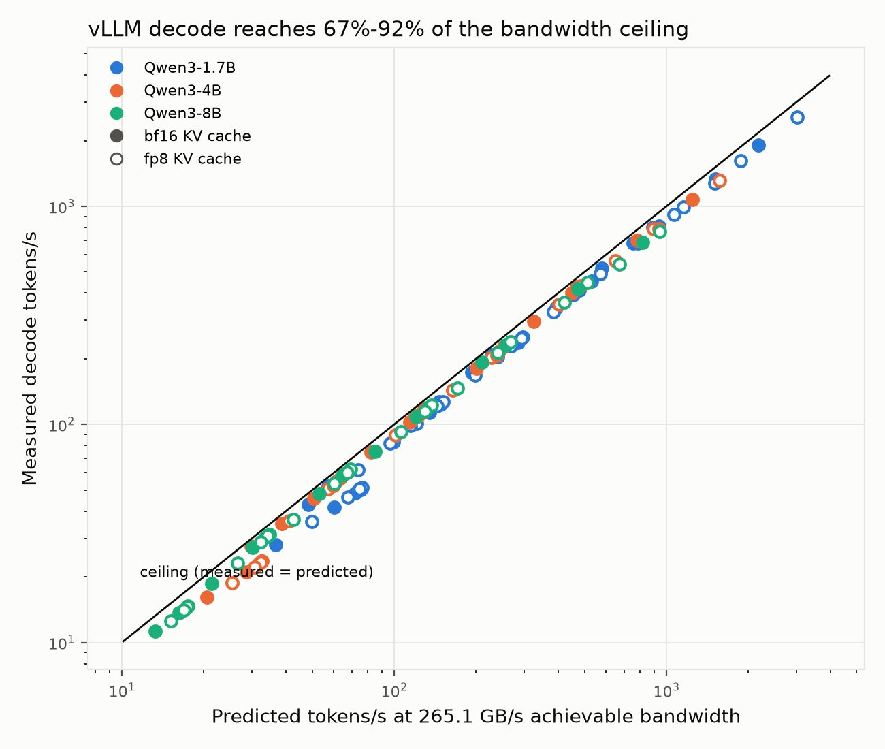
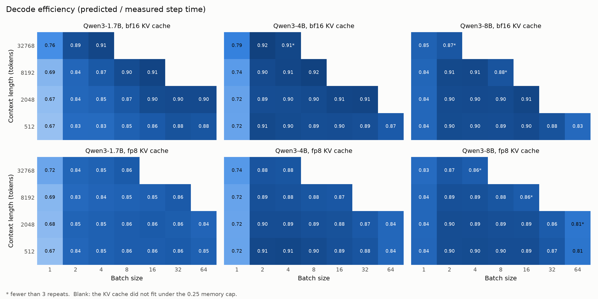
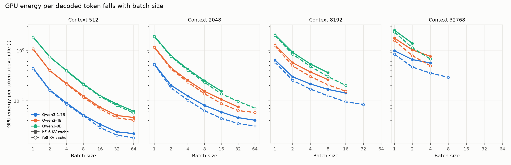

# Speed of light for LLM decode on the NVIDIA GB10

*Draft. Every number traces to a file in `results/`; the file is named where the number first appears.*

## The question

During decode, each step reads every weight and the whole KV cache from memory, so a memory-bound GPU has a hard floor on step time: bytes read over bandwidth. This project asks four questions about vLLM on an NVIDIA GB10:

1. **What fraction of that ceiling does vLLM reach?** 67–93% of the achievable bandwidth across 128 configurations of Qwen3 1.7B–8B, batch 1–64, context 512–32768 and bf16 or fp8 KV cache.
2. **Where does the rest go?** Mostly into matmul and attention kernels that read memory slower than a plain read does. At batch 1, cuBLAS's matrix-vector kernel reads the weights at 69–85% of the achievable bandwidth, and it takes 92–98% of the GPU's time. CPU overhead is small: the GPU idles 0.24–0.33 ms per step.
3. **How does GPU energy per token change?** Batching from 1 to 64 cuts it 20–30× above idle (24–37× including idle) at context 512. It is far noisier between runs than step time.
4. **Can a small model predict efficiency?** A physical model with one bandwidth per kind of read predicts it with R² = 0.958 (0.952 leaving each point out), and its fitted bandwidths match the profiles.

## Setup

| | |
| --- | --- |
| GPU | NVIDIA GB10 (sm_121), 128 GB unified LPDDR5x shared with a 20-core Arm CPU, 273 GB/s spec bandwidth |
| Software | vLLM 0.33.0, PyTorch 2.14.0+cu130, Triton 3.8.0, CUDA 13.0, driver 580.178.04 |
| Engine | vLLM offline `LLM`, `torch.compile` and CUDA graphs on (no `enforce_eager`), prefix caching off, `gpu_memory_utilization=0.25` |
| Models | Qwen/Qwen3-1.7B, 4B and 8B, bf16 weights |
| Grid | batch 1, 2, 4, 8, 16, 32, 64 × context 512, 2048, 8192, 32768 × KV cache bf16 or fp8, where the KV cache fits |
| Repeats | 3 independent sweeps per model and KV dtype, at different times and on three GB10 nodes: repeat 1 on blackwell, repeats 2 and 3 on pascal, except Qwen3-8B and Qwen3-1.7B bf16 of repeat 2 on fermi; 383 records over 128 grid points |

**Measuring decode alone.** For each point, `measure.py` generates the same batch of random exact-length prompts at 16 and at 144 output tokens, alternately: 2 warmup pairs, then 10 timed pairs. Both generations pay the same prefill, so `(long - short) / 128` is the decode step time. The KV term uses the mean context over the measured steps, the prompt length plus 80. Greedy sampling with `ignore_eos=True`; every output is checked for its exact length. A 95% CI comes from a hierarchical bootstrap that resamples repeats, then pairs within them. The repeats differ more than pairs within a run do, mostly because vLLM's KV cache allocation varies between runs.

**Cross-check.** `vllm bench latency` at Qwen3-1.7B, batch 1, input 512, differenced the same way, gives 20.48 ms per step, 0.2% from `measure.py` (`results/raw/bench_latency_*.json`).

**Caveats.**

- **Energy is GPU energy only.** The NVML total-energy counter is the only power sensor on this machine. It does not cover the CPU or the LPDDR5x memory, so it leaves out the memory traffic that decode is made of. It advances every 100 ms, so single short pairs are uncertain by about 10%; the median over 10 pairs narrows this to a few percent.
- **"Above idle" uses the idle power with the model loaded**, 10.3–14.1 W across sweeps, measured for 30 s before each sweep. With no process on the GPU, idle is 4.8 W (`results/raw/idle_power.jsonl`). Every record stores its own baseline, and energy is reported both with and without it.
- **The machine is shared.** Nobody else used the GPU during any run (checked at the start of each sweep and recorded), but other users' CPU jobs share the same memory bus, and clocks cannot be pinned without root.
- **The nodes are not identical.** Kepler, a fourth GB10 node used only to check the fp8 gap, runs FlashInfer's attention kernel about 2% slower than blackwell, with matmuls as fast. The repeats ran on different nodes, so differences between nodes are part of the spread between repeats.
- **Achievable bandwidth drifts.** The roofline uses 265.1 GB/s, measured on blackwell on 2026-11-13, a day after it booted. On 2026-11-20 and 21 the same benchmark gave 258.9–261.4 GB/s on blackwell and 261.1 GB/s on kepler (`results/raw/bandwidth_by_node.jsonl`). Against a ceiling measured on the day, efficiencies would be up to 2.4% higher.
- **The 0.25 memory cap limits the grid.** Points whose KV cache doesn't fit in what vLLM allocates are skipped and logged. vLLM's allocation varies by up to 13% between runs with identical settings, so a few points at the edge fit in some runs only. Qwen3-8B fp8 at batch 64, context 2048 has 2 repeats; Qwen3-8B bf16 at batch 32, context 2048 never fit.
- **Only bf16 weights were measured.** FP8 here means the KV cache, not the weights.
- One workaround: Python headers for Triton's launcher, unpacked into the venv. It does not change performance (`docs/SETUP.md`).

## The model

The ceiling is derived in `docs/MODEL.md`. For one decode step:

```
step_time_min = (weight_bytes + kv_bytes) / bandwidth
weight_bytes  = 2 × (every layer's parameters + final norm + lm_head)
kv_bytes      = batch × context × layers × 2 × kv_heads × head_dim × bytes per KV element
```

Dimensions come from each model's `config.json`. The weight count matches the safetensors checkpoints exactly (Qwen3-0.6B: 596,049,920 parameters read per step; Qwen3-1.7B: 1,720,574,976).

The bandwidth is measured, not taken from the spec sheet: summing a 4 GiB bf16 buffer of random values, timed with CUDA events, gives **265.1 GB/s, 97.1% of the 273 GB/s spec** (six repeats over two runs, 265.10–265.24 GB/s; `results/raw/bandwidth.jsonl`). **Efficiency** is the predicted step time at 265.1 GB/s over the measured one. Against the spec peak, every number below would be 3% lower: 0.648–0.902.

The model leaves out activations and logits, compute, host overhead and imperfect reuse of weights, so the ceiling is a lower bound on step time. No measurement beat it.

## Results



**vLLM reaches 66.7–92.9% of the ceiling** (`results/summary.csv`). The fastest point, Qwen3-1.7B with fp8 KV cache at batch 64, context 512, generates 2,573 tokens/s against a ceiling of 3,023.



- **Batch 1 is the outlier.** Efficiency is 0.667–0.849 at batch 1 (24 points) and 0.811–0.929 at batch 2 and above (104 points). Going from batch 1 to batch 2 makes the step *faster* at context 512, although it reads more KV cache: 19.85 → 16.24 ms for Qwen3-1.7B, 42.45 → 34.23 ms for Qwen3-4B, 68.47 → 64.25 ms for Qwen3-8B.
- **The batch-1 gap shrinks with model size**: median batch-1 efficiency is 0.683 for Qwen3-1.7B, 0.723 for 4B and 0.839 for 8B.
- **Long context helps**, because attention reads the KV cache closer to the ceiling than the matmuls read the weights. Qwen3-1.7B at batch 1 goes from 0.667 at context 512 to 0.761 at 32768. The best point is Qwen3-4B bf16 at batch 4, context 32768: 0.929.
- **Efficiency dips at batch 32–64**, for example to 0.83 for Qwen3-8B bf16 at batch 64, context 512.
- **An fp8 KV cache is faster but less efficient.** It halves the KV bytes, so steps are up to 37% shorter (Qwen3-1.7B at batch 64, context 2048: 79.8 → 50.3 ms). But efficiency falls: at Qwen3-4B, batch 4, context 32768, the step drops from 111.3 to 76.4 ms (31%) and efficiency from 0.929 to 0.876.

### GPU energy per token



At context 512 with a bf16 KV cache:

| Model | Batch 1, above idle | Batch 64, above idle | Ratio | Batch 1 → 64, including idle |
| --- | --- | --- | --- | --- |
| Qwen3-1.7B | 0.443 J (95% CI 0.323–0.467) | 0.0222 J (0.0214–0.0227) | 20× | 0.666 → 0.0281 J |
| Qwen3-4B | 1.056 J (1.004–1.089) | 0.0463 J (0.0449–0.0485) | 23× | 1.550 → 0.0572 J |
| Qwen3-8B | 1.853 J (1.778–1.896) | 0.0618 J (0.0603–0.0626) | 30× | 2.632 → 0.0784 J |

Over all six sweeps, the drop from batch 1 to 64 is 20–32× above idle and 24–37× including idle. Decode at batch 1 is mostly the GPU waiting on memory, so the energy is spread over few tokens; batching amortizes the same weight reads over 64.

**GPU energy is much noisier than time.** Across the 3 repeats of a point, the median step time varies by 1.6% (6.5% at most), but GPU energy above idle varies by 7% (21% at the 90th percentile, 54% at most). At Qwen3-1.7B, batch 1, context 512, the three repeats read 0.323, 0.444 and 0.469 J above idle while the step time stayed within 19–21 ms. That is why the CI in the first row above is wide. Energy claims need repeats at different times, not just more iterations in one run.

## The gap

### Profiles

Eight points were profiled with Nsight Systems and vLLM's torch profiler: the three biggest gaps (all Qwen3-1.7B at batch 1), the smallest at the time of profiling (Qwen3-4B bf16 at batch 2, context 32768), and four that test specific findings. They ran on two of the department's GB10 machines: Qwen3-1.7B bf16 at batch 1, context 512 and Qwen3-4B bf16 at batch 1 and 2, context 512 on pascal, the rest on blackwell. `profile_summary.py` splits each trace into decode steps on the GPU clock, sums kernel time per step, and divides the bytes each step must read by the time of the kernels that read them (`results/profile_summary.json`).

| Point | Efficiency | Top kernel (share of GPU busy time) | Bandwidth it reaches | GPU idle per step |
| --- | --- | --- | --- | --- |
| Qwen3-1.7B bf16, b1, c512 | 0.667 | cuBLAS `gemvx` (96%) | about 183 GB/s on weights | 0.27 ms |
| Qwen3-1.7B bf16, b1, c2048 | 0.673 | cuBLAS `gemvx` (93%) | | 0.28 ms |
| Qwen3-1.7B fp8, b1, c512 | 0.672 | cuBLAS `gemvx` (97%) | | 0.24 ms |
| Qwen3-4B bf16, b1, c512 | 0.723 | cuBLAS `gemvx` (98%) | about 194 GB/s on weights | 0.33 ms |
| Qwen3-8B bf16, b1, c512 | 0.839 | cuBLAS `gemvx` (98%) | 225 GB/s on weights | 0.33 ms |
| Qwen3-4B bf16, b2, c512 | 0.906 | CUTLASS GEMM (96%) | about 238 GB/s on weights | 0.29 ms |
| Qwen3-4B bf16, b2, c32768 | 0.923 | FlashAttention split-KV (53%), CUTLASS GEMM (46%) | about 253 GB/s on KV, 243 GB/s on weights | 0.30 ms |
| Qwen3-4B fp8, b4, c32768 | 0.876 | FlashInfer paged attention (54%), CUTLASS GEMM (46%) | about 245 GB/s on KV, 239 GB/s on weights | 0.24 ms |

"Bandwidth it reaches" is the bytes that kernel must read over its GPU time.

**The batch-1 gap is the matrix-vector kernel.** At batch 1, every linear layer runs as cuBLAS's `gemvx`, which reads the weights at 183–225 GB/s, 69–85% of what a plain read achieves. It reads larger matrices faster, which is why the batch-1 gap shrinks from Qwen3-1.7B to 8B. At batch 2, vLLM runs a CUTLASS GEMM that reads the same Qwen3-4B weights at about 238 GB/s, and the step gets faster despite doing twice the work.

**The CPU is not the bottleneck.** With CUDA graphs, the GPU idles only 0.24–0.33 ms per step, 0.3–1.4% of the step, in all eight profiles. Profiled step times agree with the measured ones within 1.5% at six of the eight points.

**Most of the fp8 gap builds up over a long run, inside FlashInfer's attention kernel.** With an fp8 KV cache, vLLM runs attention through FlashInfer's paged kernel instead of FlashAttention's split-KV kernel. Profiled on blackwell at Qwen3-4B, batch 4, context 32768, it reads the KV cache at about 245 GB/s, close to FlashAttention's 253 GB/s on bf16, and the profiled step (73.62 ms) implies an efficiency of 0.91. The sweep measured 76.38 ms, 3.7% slower. Follow-up runs at that point split the gap (`results/raw/fp8_gap_check.jsonl` and the `_blackwell1`, `_blackwell2`, `_kepler` and `_soak69` profiles in `results/profile_summary.json`):

- **In a fresh process, measurement and profile agree.** On blackwell, a fresh measurement gives 74.09 ms and two new profiles 73.44 and 73.64 ms, so the first profile reproduces. On kepler, a fresh measurement gives 75.47 ms and a profile 75.10 ms.
- **Kepler is slower than blackwell.** Kepler is a different GB10 node from the one the sweep and the first profile ran on. It is about 2% slower at this point, all of it in FlashInfer's attention kernel: it reads the KV cache at 234 GB/s against 244–245 GB/s on blackwell. Its matmuls are as fast.
- **Long runs get slower.** This point is the last of its sweep, about 69 minutes into the process. On blackwell it measures 74.09 ms fresh and 76.34 ms at the end of a sweep (3.0%). On kepler, measuring it over and over for 69 minutes raised it steadily from 75.27 to 75.94 ms (0.9%). M4's top-up points the same way: at every point measured again in a fresh process, the sweep's repeat was the slowest, by 2.6–4.5%, though on a different machine.
- **The slowdown is in the process, not the node.** On blackwell, measuring the point over and over for 68 minutes raised it from 74.13 to 74.50 ms (0.5%). A new process started right after measured 74.17 ms again.
- **It is in the attention kernel.** Profiled on blackwell after the point had been measured for 69 minutes in the same process, the step takes 74.52 ms against 73.44–73.64 ms fresh. Attention takes 40.33 ms per step against 39.46–39.54 ms (the KV cache read falls from 244–245 to 240 GB/s); the matmuls take 33.78 ms against 33.48–33.70 ms, and GPU idle is unchanged at 0.23 ms. It is the same kernel that is slower on kepler.
- **Time alone explains only part of it.** One point repeated for an hour slows by 0.5–0.9%, while the end of a real sweep is 3.0% slower than fresh. A sweep runs many different points first, and that history seems to matter more than how long the process has run.
- **Not heat, clocks or KV block placement.** Before and after every measurement the GPU read at most 72 °C and held about 2400 MHz, with no throttling reported. Running one generation at every earlier grid point first, to scatter the KV cache blocks the way a sweep does, gave 75.17 ms, the same as fresh.

**Why FlashInfer's attention kernel gets slower in a long-running process is an open question.** Neither heat, the SM clock, the node's CPU load (under 1% busy through the blackwell runs) nor one pass of KV block scattering explains it. The sweep runs the grid context by context, so the points measured late are the long-context ones, and their measured efficiency is probably low by up to a few percent.

### The gap model

The roofline reads every byte at 265.1 GB/s. The profiles show that each kind of read has its own bandwidth, so the gap model fits step time as:

```
step time = weight bytes / matmul bandwidth  (one per model at batch 1; one for batch ≥ 2)
          + KV bytes / attention bandwidth   (one for bf16, one for fp8)
          + fixed time
          + batch × weight GB × time per sequence per weight GB
```

It is fitted to all 128 points by least squares on relative error (`gap_model.py`, `results/gap_model.json`). CIs are 95% bootstraps that resample points within each model and batch-1-or-not group.

| Term | Fit (95% CI) | Profiles |
| --- | --- | --- |
| Batch-1 matmul bandwidth, Qwen3-1.7B | 186.1 GB/s (182.8–189.0) | about 183 GB/s |
| Batch-1 matmul bandwidth, Qwen3-4B | 195.4 GB/s (194.2–196.6) | about 194 GB/s |
| Batch-1 matmul bandwidth, Qwen3-8B | 225.3 GB/s (224.2–226.3) | 225 GB/s, profiled after the fit |
| Batch ≥ 2 matmul bandwidth | 244.0 GB/s (242.5–245.7) | about 238–243 GB/s |
| bf16 attention bandwidth | 245.8 GB/s (242.9–248.5) | about 253 GB/s |
| fp8 attention bandwidth | 227.7 GB/s (224.8–230.3) | 234–245 GB/s depending on the machine; the fit also absorbs the long-run slowdown |
| Fixed time per step | 1.09 ms (0.86–1.31) | GPU idle 0.24–0.33 ms; the rest is small kernels (norms, activations, sampling) |
| Time per sequence per weight GB | 0.0043 ms (0.0020–0.0060) | not profiled |

**It predicts efficiency with R² = 0.958**, residual std 0.013 in efficiency. Predicting each point from a fit to the other 127 gives R² = 0.952, so it is not overfitting. The batch-1 bandwidths match the profiles within 2%. The Qwen3-8B one was a prediction: the fit gave 225.3 GB/s before that point was profiled, and the profile measured 225.

The last term grows with batch × weights, which is the shape of the matmul arithmetic. It is what makes efficiency dip at batch 64: 4.2 ms of Qwen3-8B's 93.7 ms step at batch 64, context 512. The profiles don't yet show that it is arithmetic.

For comparison, the brief's starting point, a linear regression of efficiency on log2 batch, log2 context, log2 model size and KV dtype, reached R² = 0.327 when fitted before the top-up (`results/gap_model.json` at commit `e6bffb8`). Adding a batch-1 indicator and its interaction with model size gave 0.868 (the same file at `714fd95`). The physical model does better with 8 parameters, each of which is a bandwidth or a time that a profiler can check.

## What would change on datacenter GPUs

These are expectations from the mechanism above, not measurements.

- **Fixed costs weigh more.** An H100 SXM has 3.35 TB/s of HBM3 (spec), about 12× the GB10. Qwen3-8B's batch-1 ceiling drops from 57 ms to about 4.7 ms per step, but the parts that don't scale with bandwidth stay: the 0.24–0.33 ms of GPU idle and the launch cost of the 1 ms of fixed time. Together they would be up to a quarter of a step instead of 2%, so CPU overhead and CUDA graph coverage matter far more there.
- **Kernel bandwidths are not portable.** The 69–85% batch-1 figure is cuBLAS's `gemvx` on sm_121. Datacenter GPUs get different kernels and better-tuned libraries, and the gap model's bandwidths would need refitting on each GPU. The method carries over: fit one bandwidth per kind of read and check it against a profile.
- **The batch where compute shows up moves** with each GPU's ratio of FLOP/s to bytes/s. This grid stayed memory-bound up to batch 64, apart from the small per-sequence term; a GPU with a different ratio would show that term at a different batch.
- **Energy would include memory.** NVML on datacenter boards reports power for the whole board, HBM included. On the GB10 it covers the GPU only, so these J/token figures leave out the energy of the very memory reads that dominate decode. Numbers from the two are not comparable.
- **No shared memory bus.** The GB10's CPU and GPU share LPDDR5x, so other users' CPU work is a source of noise here. Discrete GPUs don't have that, though multi-GPU setups add communication that this single-GPU study doesn't cover.

## How to reproduce

1. **Environment.** Follow `docs/SETUP.md`: a Python 3.12 venv, `pip install vllm --extra-index-url https://download.pytorch.org/whl/cu130`, the package with `pip install --no-deps -e .`, and the Python-headers workaround for Triton. `pre-commit run -a` and `pytest -m "not gpu"` must pass.
2. **Instruments.** Achievable bandwidth: `timeout 10m python -m decode_sol.bandwidth`. Idle power: `timeout 10m python -m decode_sol.energy`.
3. **Plan.** `python -m decode_sol.grid` prints the feasible points and the estimated GPU minutes per sweep.
4. **Sweep.** For each model (Qwen/Qwen3-1.7B, 4B, 8B), each KV cache dtype (`auto`, `fp8`) and each of 3 repeats, run `bash scripts/run_sweep.sh --timeout <estimate> --model <model> --grid full --kv-cache-dtype <dtype>`. Each sweep appends to `results/raw/decode.jsonl`. To top up points that didn't fit in a run, add `--points BATCHxCONTEXT ...`.
5. **Analysis.** `python -m decode_sol.analyze` writes `results/summary.csv`, `python -m decode_sol.plots` the figures in `plots/`, and `python -m decode_sol.gap_model` writes `results/gap_model.json`.
6. **Profiles.** `bash scripts/run_profile.sh --nsys --model <model> --batch-size <n> --context-len <n> [--kv-cache-dtype fp8]` for Nsight Systems, the same without `--nsys` for the torch profiler. Then `python -m decode_sol.profile_summary` writes `results/profile_summary.json`.
7. **fp8 gap check.** `timeout --kill-after=30s 25m python -m decode_sol.step_drift --model Qwen/Qwen3-4B --kv-cache-dtype fp8 --batch-size 4 --context-len 32768 --mode fresh` (or `--mode scramble`, or `--mode soak --minutes 69` under a longer timeout) appends to `results/raw/fp8_gap_check.jsonl`.

The full grid took about 7 GPU hours per repeat (6.9 h of sweep time in the records, plus model loading). Every record in `results/raw/` stores the git commit, versions, model revision, engine settings, KV cache capacity, idle baseline and the GPU processes seen at start.
